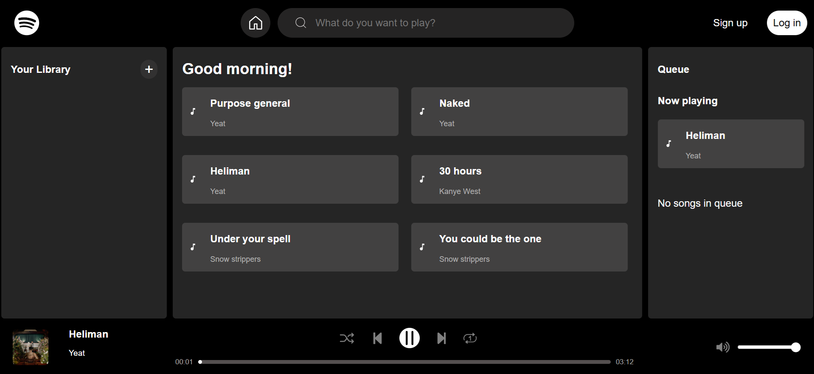
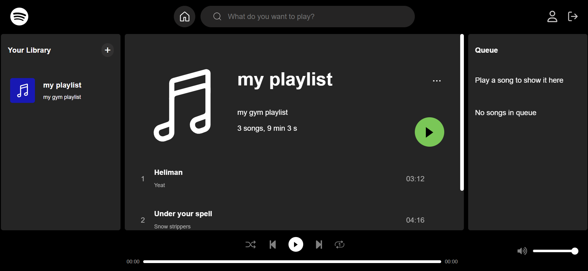
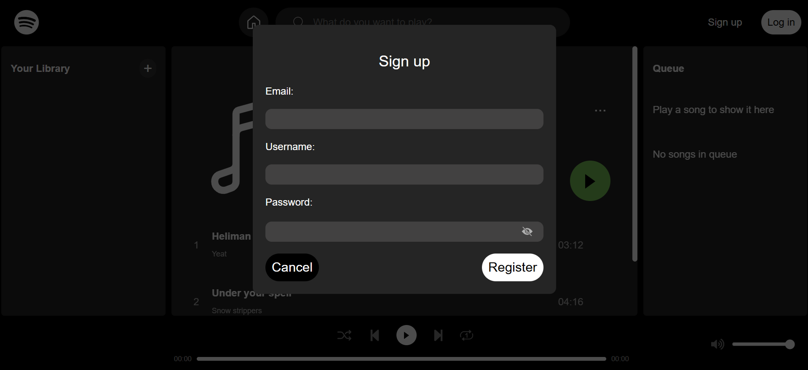

# Spotify Clone 🎵

A full-stack music streaming application inspired by Spotify, built with React, Vite, Node.js, Express, and SQLite.

The project recreates a Spotify-inspired music experience with a music catalog, audio playback, user authentication, and personal playlists.

## ✨ Features

- **User authentication** — register, log in, and log out using cookie-based sessions.
- **Music search** — search for artists, songs, and albums; song results also include songs by matching artists.
- **Artist and album pages** — browse an artist's songs and albums, or view the songs on an album.
- **Audio player** — play, pause, skip forward and backward, seek through a song, and adjust or mute the volume.
- **Playback options** — shuffle the current song list or repeat a song once or continuously.
- **Queue management** — add songs to the queue, play queued songs, remove individual songs, and clear the queue.
- **Personal playlists** — create, edit, and delete playlists; add songs to a playlist or remove them.
- **User-specific data** — authenticated users can access and manage their own playlists.
- **Resizable sidebars** — show or hide the library and queue panels and adjust their widths.
- **Persistent storage** — store users, sessions, artists, albums, songs, and playlists in SQLite.

## 🛠️ Tech Stack

**Frontend**

- React
- Vite
- JavaScript
- CSS

**Backend**

- Node.js
- Express.js
- SQLite
- better-sqlite3
- Session-based authentication with cookies

## 📸 Screenshots

### Home Page



### Playlist View



### Authentication



## 🚀 Getting Started

### Prerequisites

- Node.js and npm
- Git

### Installation

1. Clone the repository and install the frontend dependencies from the project root:

   ```bash
   git clone https://github.com/GrufasXd/Spotify-clone.git
   cd Spotify-clone
   npm install
   ```

2. Start the frontend development server:

   ```bash
   npm run dev
   ```

3. In a separate terminal, install the backend dependencies and start the Express server:

   ```bash
   cd backend
   npm install
   node server.js
   ```

4. Open the frontend URL displayed by Vite, usually `http://localhost:5173`.

   The backend runs separately at `http://localhost:3001`.

## 🗄️ Database

The application uses SQLite through `better-sqlite3` to store user accounts, sessions, artists, albums, songs, and playlist data. On startup, the backend creates the required tables and adds sample music data when the songs table is empty.

## 📚 What I Learned

- Building a full-stack application with React and Express.
- Designing and connecting REST API endpoints.
- Implementing session-based authentication with HTTP cookies.
- Working with relational databases and SQL queries.
- Managing user-specific data and playlist relationships.
- Connecting frontend components to a backend API.

## 📌 Future Improvements

- Add catalog filters and sorting, such as filtering songs by artist or album.
- Save the playback queue between app sessions.
- Add genre- or mood-based browsing and personalized recommendations.
- Improve the layout and controls for small screens.
- Deploy the application and provide an online live demo.

---

**Note:** This is an independent project inspired by Spotify's user interface and functionality. It is not affiliated with or endorsed by Spotify.
